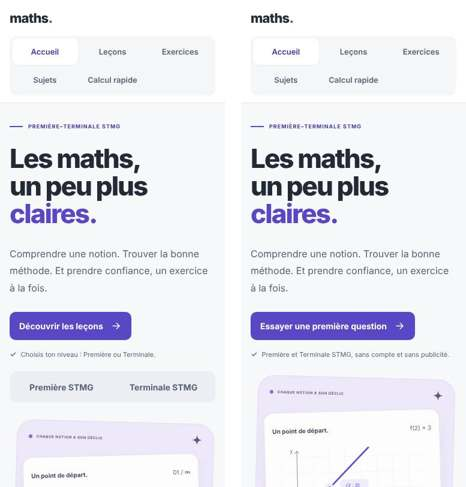
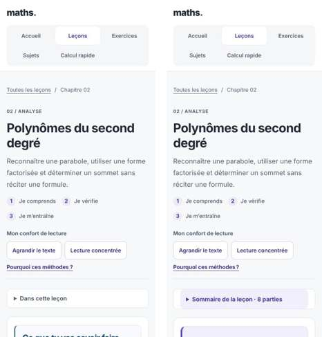
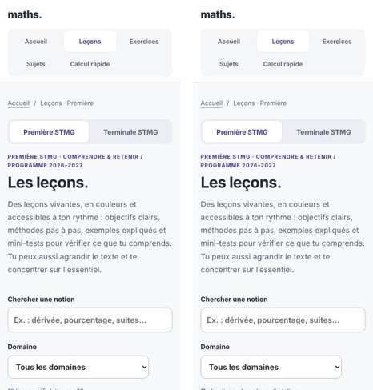
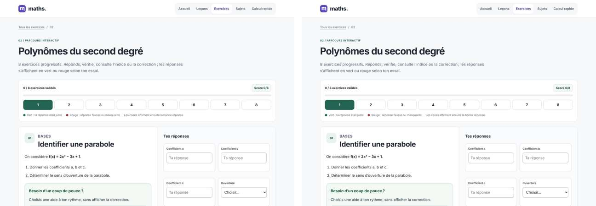
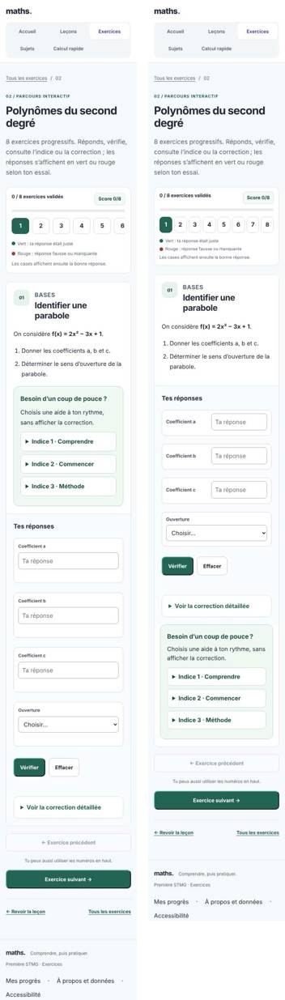
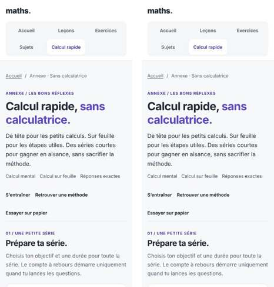
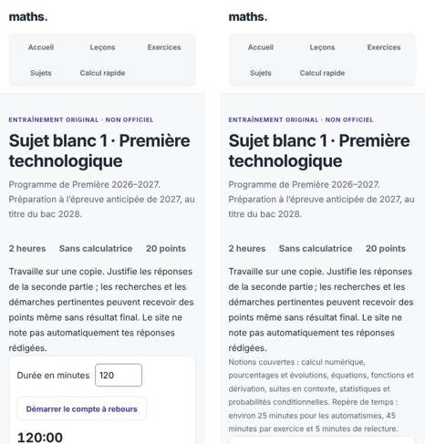

# Rapport d’améliorations — variantes, corrigés et disposition

Branche `amelioration-variantes-et-corriges`, sept commits atomiques (lots 1 à 6 et 5 bis) à partir de `249101c`. Le site reste statique : pas de framework, pas de dépendance réseau, pas de CDN, et la CSP de `_headers` (`script-src 'self'`) n’a pas changé. Aucune URL ne change. Aucune nouvelle donnée n’est stockée : le suivi local facultatif `maths-stmgdls:acquis:v1` garde son format.

Le détail des arbitrages, lot par lot, est dans `docs/audit-et-arbitrages.md`, sections 10 à 15.

## 1. En bref

- **Variantes** : chaque clic sur « Nouvelle variante » tire une graine aléatoire. Le générateur garde la difficulté à ±20 % de l’exercice d’origine. Une mémoire des 10 dernières variantes empêche les répétitions. Les 183 modèles (129 de Première, 54 de Terminale) ont été réécrits sur ce principe.
- **Réponses à choix** : sur 2 000 tirages, chaque réponse à deux choix est juste entre 37 % et 63 % du temps. La même bonne réponse ne peut pas sortir trois fois de suite.
- **Corrigés** : tous suivent le plan Méthode → Calculs → Conclusion, avec la rédaction attendue au bac et les unités. Cela vaut pour les exercices d’origine, les variantes, les sujets blancs, les problèmes et la série papier.
- **Écriture** : plus de notation cassée (exposants perdus, « 1 × », « + (−24) », entités HTML). La typographie française est appliquée partout : espaces insécables et apostrophe typographique. Des tests automatiques vérifient ces deux points.
- **Ergonomie** :
  - imprimer le corrigé du calcul rapide ne retire plus de points sans confirmation ;
  - les chronos se mettent en pause quand l’onglet est masqué ;
  - les décomptes sont exacts ;
  - les liens ont des noms uniques ;
  - sur téléphone, « Vérifier » est 490 à 550 px plus haut dans les séries ;
  - les lignes des leçons sont ramenées à environ 70 caractères.
- **Batterie complète** : tous les tests passent (section 8). Les vérifications « à la main », scriptées à 1 280 px et 375 px, ne relèvent aucun problème (section 6).

## 2. Problème → correction → preuve

| Problème constaté | Correction | Preuve |
|---|---|---|
| « Nouvelle variante » ajoutait 1 à un paramètre `k` : la suite était prévisible et bornée à 24 états. | Graine mulberry32 tirée par `crypto.getRandomValues`, modèles déclaratifs, mémoire anti-répétition (`assets/exercices-variants.js`). | `tests/test_cloture.js` (183 modèles, 54 900 variantes) ; Lot 6 : 100 variantes affichées dans le navigateur, toutes distinctes (section 6). |
| La taille des nombres dérivait d’un clic à l’autre (exemple : C(35) ≈ 4 790 sans calculatrice). | Bande de difficulté ±20 % autour de l’exercice d’origine ; jusqu’à 200 tirages refusés avant d’accepter. | `tests/test_terminale.js` (108 000 variantes) ; section 3 (rapport de difficulté entre 0,83 et 1,20 sur 2 000 tirages). |
| Les réponses à choix étaient toujours les mêmes (« Vers le haut », « Négatif », « Non »). | Signes et sens tirés au hasard ; une même bonne réponse est refusée trois fois de suite. | Section 4 : les 54 champs à deux choix restent entre 37 % et 63 %. |
| Les corrigés donnaient le résultat sans la méthode. | `C(méthode, calculs, conclusion)` pour les 183 modèles, les 129 exercices d’origine, les sujets blancs, les 8 problèmes et la série papier ; tableaux de signes et de variations accessibles. | `tests/test_cloture.py` ; Lot 6 : « Méthode » et « Conclusion » présents dans les 10 corrigés ouverts. |
| Trois énoncés de Première demandaient une calculatrice (1,2¹⁰, 1,1¹⁰, √2). | La valeur utile est donnée dans l’énoncé, comme dans les variantes. | Relecture des différences de JSON (audit, section 11) ; aucun test ne vérifie spécifiquement cette valeur. |
| Des libellés affichaient « &amp;lt; » et « &amp;gt; ». | Caractères < et > ; le moteur échappe une seule fois. | Test de libellés dans `tests/validate_site.py`. |
| Écritures cassées : « 1 × », « (−1) × 36 », « + (−24) », « 13/1 », exposants perdus, ^ visible. | Utilitaire `times`, contrôle `lint` des motifs interdits, exposants Unicode ou ``. | `tests/test_notation.py` (72 pages, 5 motifs) ; contrôle d’artefacts du Lot 6. |
| Typographie : 4 893 écarts (espaces avant « : ; ! ? », guillemets, unités, apostrophe). | `tools/typographie.py` (HTML, JSON, titres) et `assets/typographie.js` (texte produit par JavaScript). | `tests/test_typographie.py` : 0 écart sur 72 pages. |
| Logarithme : lettres différentes d’une partie à l’autre ; pas de tableau de valeurs. | Notations harmonisées, mise en garde sur la place de l’inconnue, tableau et graphique de log(x), méthode du nombre de chiffres. | Audit, section 12 ; empreintes relues. |
| Probabilités conditionnelles : la formule « une intersection n’est pas une probabilité conditionnelle » était inexacte. | Formulation exacte, formule des probabilités totales nommée. | Audit, section 12. |
| Le sommaire des leçons s’affichait déplié puis se repliait, ce qui décalait la page (CLS 0,17). | Sommaire, options de lecture et bouton des corrections écrits dans la page ; règle `noscript`. | `tests/browser_cloture.py` : CLS 0 (budget ≤ 0,1). |
| Calcul rapide : imprimer le corrigé retirait des points sans prévenir. | Confirmation dans la page ; « Annuler » ne change rien, « Oui » fige les points. | `tests/browser_calcul_rapide.py`, `tests/browser_evolution.py`. |
| Le chrono continuait quand l’onglet était masqué. | `QuickCountdown.autoPause` (calcul rapide et sujets blancs, avec case pour une simulation stricte). | `tests/test_countdown.js`, `tests/test_interface.py`. |
| Décomptes faux sur les catalogues et dans les métadonnées. | « 11 chapitres · 4 repères · 1 atelier », « 8 chapitres · 1 repère », « 121 + 8 » et « 48 + 6 » exercices. | `tests/browser_smoke.py` (catalogues, y compris après un filtre). |
| Plusieurs liens au même nom (« Commencer la série », « Leçon »…) menaient à des pages différentes. | Texte masqué visuellement qui complète le nom (`tools/liens_accessibles.py`). | Nouveau `tests/test_noms_liens.py` : 9 noms ambigus dans la version d’origine, 0 maintenant. |
| Descriptions de page en double. | Descriptions distinctes, reprises par `og:description`. | `tests/validate_site.py` exige une description unique. |
| `exercices/fonctions.html` dépassait le budget de poids : chaque série chargeait les six générateurs. | Chaque page ne charge que le générateur de son chapitre. | Budgets de `tests/browser_cloture.py`. |
| Sur téléphone, « Vérifier » arrivait après les aides, à environ 2 080 px du haut. | Sous 900 px, les aides passent sous « Vérifier » et la correction ; réponses plus compactes. | Mesure à 375 px, sur l’exercice 1 : 2 080 → 1 528 px (Première, second degré), 2 093 → 1 605 px (Terminale, loi binomiale). |
| Lignes de 97 à 99 caractères dans les leçons sur ordinateur. | Paragraphes limités à 54 cadratins au-delà de 740 px. | Mesure ligne par ligne : médiane 70 et 69 caractères. |
| Lot 6 : sur téléphone, un intitulé long écrasait le champ de réponse (jusqu’à 22 px de large ; défaut introduit au Lot 5 bis). | Intitulé et champ sur une ligne seulement quand la place suffit ; sinon le champ passe dessous, sur toute la largeur. | Nouveau contrôle dans `tests/browser_smoke.py` : aucun champ sous 120 px, de 320 à 1 440 px. Il échoue sur la version précédente. |
| Tableaux des corrigés sur téléphone : la grille de maîtrise de la langue débordait de plus de 1 000 px ; les intitulés de ligne disparaissaient en faisant défiler. | Grille de texte qui passe à la ligne ; tableaux de signes plus compacts ; colonne des intitulés fixe pendant le défilement. | Mesure à 375 px : la grille tient dans l’écran ; les formules restent sur une ligne. |

## 3. Cinq modèles, cinq variantes chacun

Le score de difficulté est celui du générateur : taille des nombres, nombre d’étapes, signes et fractions. Le rapport divise ce score par celui de l’exercice d’origine ; il doit rester entre 0,80 et 1,20. Les graines ont été tirées au hasard, comme sur le site. Chaque ligne se reproduit avec `ExerciseVariants.generate(chapitre, rang, graine)`.

Ce tableau montre des tirages indépendants. Dans la page, la mémoire des 10 dernières variantes empêche en plus qu’un même énoncé revienne aussitôt.

### Second degré, exercice 6 « Maximiser un bénéfice » (Première, score d’origine 45,3)

Origine : B(x) = −x² + 10x − 9 sur [0 ; 10], en centaines d’euros. Réponses : 5 ; 16 ; 1 ; 9.

| Graine | Énoncé | Score | Rapport | Réponses (x optimal ; maximum ; racines) |
|---|---|---|---|---|
| 535570362 | Coopérative, x tonnes de fruits, en milliers d’euros : B(x) = −x² + 18x − 56 sur [0 ; 18] | 50,6 | 1,12 | 9 ; 25 ; 4 ; 14 |
| 1040300526 | Coopérative : B(x) = −2x² + 24x − 54 sur [0 ; 12] | 50,4 | 1,11 | 6 ; 18 ; 3 ; 9 |
| 1241526811 | Entreprise, x centaines d’objets : B(x) = −2x² + 12x − 10 sur [0 ; 6] | 44,1 | 0,97 | 3 ; 8 ; 1 ; 5 |
| 245321562 | Coopérative : B(x) = −x² + 10x − 9 sur [0 ; 10] (mêmes nombres que l’origine, autre contexte) | 45,3 | 1,00 | 5 ; 16 ; 1 ; 9 |
| 1302757026 | Association, prix x d’un billet en euros : B(x) = −2x² + 16x − 24 sur [0 ; 8] | 47,0 | 1,04 | 4 ; 8 ; 2 ; 6 |

Sur 2 000 tirages : 96 énoncés différents, rapport entre 0,91 et 1,18. Contextes : association 34 %, coopérative 35 %, entreprise 32 %.

### Suites géométriques, exercice 5 « Déterminer un premier seuil » (Première, score d’origine 44,2)

Origine : uₙ = 100 × 1,2ⁿ. Réponses : 172,8 ; 207,36 ; 4.

| Graine | Énoncé | Score | Rapport | Réponses |
|---|---|---|---|---|
| 594575971 | uₙ = 50 × 0,9ⁿ | 38,1 | 0,86 | 40,5 ; 36,45 ; 3 |
| 2002685843 | uₙ = 500 × 0,8ⁿ | 45,0 | 1,02 | 400 ; 320 ; 2 |
| 74399801 | uₙ = 100 × 0,5ⁿ | 41,0 | 0,93 | 12,5 ; 6,25 ; 4 |
| 1594678486 | uₙ = 50 × 0,5ⁿ | 38,1 | 0,86 | 12,5 ; 6,25 ; 3 |
| 1516755849 | uₙ = 100 × 1,2ⁿ | 44,2 | 1,00 | 172,8 ; 207,36 ; 4 |

Sur 2 000 tirages : 26 énoncés différents (premier terme, raison croissante ou décroissante, rang), rapport entre 0,83 et 1,12. C’est le modèle le moins varié de l’échantillon, parce que les calculs doivent rester faisables à la main.

### Probabilités conditionnelles, exercice 8 « Inverser une probabilité conditionnelle » (Première, score d’origine 29,8)

Origine : 10 % de pièces défectueuses, test positif pour 90 % d’entre elles et pour 20 % des autres. Réponses : 0,09 ; 0,27 ; 0,333333.

| Graine | Énoncé | Score | Rapport | Réponses (P(D ∩ T) ; P(T) ; P(D sachant T)) |
|---|---|---|---|---|
| 2115364688 | Messagerie : 5 % d’indésirables, filtre 95 % / 5 % | 29,9 | 1,00 | 0,0475 ; 0,095 ; 0,5 |
| 2124705226 | Contrôle de fabrication : 10 %, test 95 % / 5 % | 29,9 | 1,00 | 0,095 ; 0,14 ; 0,678571 |
| 1770075090 | Messagerie : 10 %, filtre 80 % / 5 % | 29,6 | 0,99 | 0,08 ; 0,125 ; 0,64 |
| 1801436371 | Contrôle de fabrication : 10 %, test 95 % / 5 % (même tirage que la deuxième ligne) | 29,9 | 1,00 | 0,095 ; 0,14 ; 0,678571 |
| 1149708587 | Messagerie : 5 %, filtre 80 % / 20 % | 29,6 | 0,99 | 0,04 ; 0,23 ; 0,173913 |

Sur 2 000 tirages : 81 énoncés différents, rapport entre 0,99 et 1,00. Contextes : messagerie 33 %, population 35 %, fabrication 31 %. Deux tirages indépendants peuvent coïncider, comme ici ; dans la page, la mémoire anti-répétition l’empêche sur dix clics consécutifs.

### Dérivées, exercice 1 « Pente d’une sécante » (Première, score d’origine 28)

Origine : f(x) = x², abscisses 1 et 3. Réponses : 1 ; 9 ; 4.

| Graine | Énoncé | Score | Rapport | Réponses (f(a) ; f(b) ; taux) |
|---|---|---|---|---|
| 244341103 | f(x) = 2x² − 5, abscisses −1 et 3 | 32,5 | 1,16 | −3 ; 13 ; 4 |
| 1989538237 | f(x) = −2x² + 1, abscisses 0 et 2 | 30,0 | 1,07 | 1 ; −7 ; −4 |
| 622394265 | f(x) = x² − 4, abscisses 1 et 3 | 28,8 | 1,03 | −3 ; 5 ; 4 |
| 1750412306 | f(x) = 2x² + 5, abscisses 0 et 2 | 29,5 | 1,05 | 5 ; 13 ; 4 |
| 78323064 | f(x) = x² − 3, abscisses −1 et 3 | 29,5 | 1,05 | −2 ; 6 ; 2 |

Sur 2 000 tirages : 249 énoncés différents, rapport entre 0,92 et 1,20.

### Logarithme, exercice 3 « Équation et seuil » (Terminale, score d’origine 25)

Origine : résoudre 3ˣ = 81, puis trouver le premier entier n tel que 3ⁿ > 81. Réponses : 4 ; 5.

| Graine | Énoncé | Score | Rapport | Réponses |
|---|---|---|---|---|
| 1734021435 | 3ˣ = 9, puis 3ⁿ ≥ 9 | 24,0 | 0,96 | 2 ; 2 |
| 564464719 | 8ˣ = 64, puis 8ⁿ ≥ 64 | 27,5 | 1,10 | 2 ; 2 |
| 494024985 | 3ˣ = 81, puis 3ⁿ ≥ 81 | 25,0 | 1,00 | 4 ; 4 |
| 1454843871 | 2ˣ = 2 048, puis 2ⁿ ≥ 2 048 | 28,8 | 1,15 | 11 ; 11 |
| 578738911 | 2ˣ = 128, puis 2ⁿ ≥ 128 | 27,0 | 1,08 | 7 ; 7 |

Sur 2 000 tirages : 74 énoncés différents, rapport entre 0,91 et 1,17. Le seuil est tantôt strict (>), tantôt large (≥) : l’élève doit lire l’inégalité, car la réponse change d’une unité.

## 4. Répartition des réponses à choix

Mesure sur 2 000 tirages de chacun des 183 modèles, avec `node tools/mesures_variantes.js`. Les graines étant aléatoires, les pourcentages varient d’environ un point d’une exécution à l’autre.

- **54 champs à deux choix** (Oui / Non, Croissante / Décroissante, Positif / Négatif…) : chaque réponse est juste entre **37,6 %** et **62,4 %** du temps. Les moins équilibrés :
  - probabilités conditionnelles, exercice 7 : Oui 62 % · Non 38 % ;
  - variables aléatoires, exercice 4 : Oui 61 % · Non 39 % ;
  - suites arithmétiques, exercice 2 : Arithmétique 61 % · Géométrique 39 % ;
  - variations, exercice 7 : Négatif 59 % · Positif 41 %.
- **13 champs à trois choix ou plus** : la réponse la plus fréquente est juste au plus **33,5 %** du temps. Exemples :
  - décroissante 34 % · constante 34 % · croissante 33 % (Terminale, exponentielles) ;
  - six statuts entre 16 % et 18 % (Python et tableur) ;
  - douze inéquations entre 7 % et 9 % (Fonctions).
- Les parts très faibles, jusqu’à 0,1 %, concernent des options qui ne sont presque jamais justes parmi beaucoup d’autres (par exemple 35 intervalles possibles). Elles ne permettent donc pas de deviner la réponse.
- Dans la page, une même bonne réponse à choix n’est jamais tirée trois fois de suite.

## 5. Empreintes de contenu protégé

Les empreintes (`tests/interface-content.json`, `tests/evolution-mathematics.json`) n’ont été mises à jour qu’après relecture des différences, lot par lot. La justification complète est dans l’audit.

| Lot | Entrées mises à jour | Justification (audit) |
|---|---|---|
| 1 | Les six `variants-*.js`, les six `coaching-*.js`, `terminale-exercices.js`, `calcul-rapide-data.js`, `exercices-variants.js`, `exercices.js`, `exercices-renderer.js`, `fonctions-coaching.js` ; zone `<main>` des neuf séries de Terminale (version sans JavaScript régénérée). | Section 10 : nouveau moteur à graine, aides rendues justes pour les nouvelles variantes. |
| 2 | Les 15 pages `exercices/*.html` (données JSON), les générateurs, `exercices/fonctions.html`, `<main>` de `t-inverse` et `t-statistiques`. | Section 11 : corrigés structurés ; trois valeurs données ; trois libellés à entité. Relecture hors corrigé : rien d’autre ne change. |
| 3 | `<main>` des 25 leçons, `cours.js`, `graphiques-interactifs.js`. | Section 12 : prérequis, routine de révision, passages réécrits listés. |
| 4 | `cours.js`. | Section 13 : décompte du catalogue. |
| 5 | Toutes les zones protégées. | Section 14 : typographie seule. Après normalisation des espaces insécables, des apostrophes et des textes masqués, il ne reste qu’un écart : le lien en double retiré dans les neuf leçons de Terminale. |
| 5 bis | `exercices.js`. | Section 15 : déplacement du panneau d’aides, aucun texte modifié. |
| 6 | Aucune. | Seules des feuilles de style et des tests changent. |

### Changements de contenu des leçons et des corrigés

- **Leçons (Lot 3)**, sur les 25 leçons :
  - encadré « Prérequis » ;
  - routine de révision J+1 / J+7 / J+21 ;
  - bouton « Afficher toutes les corrections » ;
  - sommaire écrit dans la page.
- **Leçons réécrites en partie** : logarithme décimal (Terminale), probabilités conditionnelles (Première) et conditionnement (Terminale). Deux pauses mémoire écrivent les puissances en notation mathématique.
- **Corrigés (Lot 2)** : les 129 exercices d’origine de Première, dont 11 avec un corrigé adapté à leur énoncé particulier ; les sujets blancs 1 et 2 (consignes précisées, automatismes 3, 9 et 10 revus, grille de maîtrise de la langue) ; les 8 problèmes ; la série papier du calcul rapide.

## 6. Vérifications « à la main » (scriptées, Lot 6)

Les parcours ont été joués dans Chromium à 1 280 px puis à 375 px. Pour chaque série :
- une réponse fausse ;
- dix variantes successives, chacune vérifiée avec les bonnes réponses ;
- puis le corrigé ouvert.

| Série | Exercice | Variantes distinctes | Bonnes réponses acceptées | Réponse fausse signalée | Corrigé (Méthode, Conclusion, solutions affichées) | « Vérifier » à 375 px |
|---|---|---|---|---|---|---|
| Second degré | 6 | 10/10 aux deux largeurs | 10/10 | oui | oui, 4 champs, aucun point gagné | 1 596 px |
| Suites géométriques | 5 | 10/10 | 10/10 | oui | oui, 3 champs | 1 376 px |
| Probabilités conditionnelles | 8 | 10/10 | 10/10 | oui | oui, 3 champs | 1 593 px |
| Logarithme (Terminale) | 3 | 10/10 | 10/10 | oui | oui, 2 champs | 1 483 px |
| Loi binomiale (Terminale) | 2 | 10/10 | 10/10 | oui | oui, 2 champs | 1 512 px |

Pour ces séries, la position est mesurée sur l’exercice indiqué, ouvert directement par son ancre. Elle n’est donc pas comparable aux mesures de la section 2, prises sur l’exercice 1.

Autres parcours, aux deux largeurs :
- **Accueil** : la question « Combien vaut f(2) ? » répond « Pas encore : remplace x par 2… » pour 4 et « Bravo : f(2) = 2 + 1 = 3… » pour 3.
- **Diagnostic** : dix réponses donnent cinq bilans. Le suivi reste désactivé tant que l’élève ne l’active pas.
- **Révision guidée** : indice, réponse « Juste avec une aide », exercice équivalent différent, corrigé.
- **Calcul rapide** :
  - le chrono est figé pendant la pause ;
  - « Annuler » laisse le corrigé imprimable décoché ;
  - « Oui, figer mes points » bloque la vérification ;
  - l’aperçu avant impression est contrôlé.
- **Leçon (second degré)** : sommaire à 8 liens, bouton des corrections, 3 tableaux défilants dans leur zone.
- Partout, le script a contrôlé l’absence de débordement horizontal, d’erreur JavaScript et d’artefact : `NaN`, `undefined`, `1 ×`, `+ −`, `−0`, entités, `$`, `\frac`.

Seul constat, déjà présent dans la version d’origine : seule l’accueil déclare une icône. Les autres pages demandent donc `/favicon.ico`, qui n’existe pas (section 9).

## 7. Captures avant / après

Les captures sont dans `docs/captures/` : à gauche, la version d’origine (`249101c`) ; à droite, cette branche.

| Capture | Ce qui change |
|---|---|
|  | Accueil, ordinateur : le bouton principal devient « Essayer une première question » et mène à la question sur f(2). Les fragments du dessin deviennent « f(2) = 3 » et « 2 + 1 = 3 ». Les boutons de niveau sous le bouton principal sont retirés. |
|  | Accueil, téléphone : mêmes changements ; la mention « Première et Terminale STMG, sans compte et sans publicité » remplace « Choisis ton niveau ». |
|  | Leçon, ordinateur : encadré « Prérequis », bouton « Afficher toutes les corrections (3) », sommaire « Sommaire de la leçon · 8 parties », lignes d’environ 70 caractères. |
|  | Leçon, téléphone : le sommaire est mis en évidence et nomme son nombre de parties. |
|  | Leçon de Terminale (logarithme) : même gabarit qu’en Première (prérequis, bouton des corrections, sommaire à 10 parties). |
|  | Catalogue des leçons, téléphone : même aspect. Le décompte corrigé et les noms de liens uniques sont plus bas ou invisibles à l’écran. |
|  | Série, ordinateur : disposition inchangée (aides à côté de l’énoncé), typographie corrigée. |
|  | Série, téléphone : énoncé, réponses, « Vérifier » puis correction, et seulement ensuite les aides. Les huit numéros d’exercice tiennent sur une ligne. |
|  | Calcul rapide, téléphone : haut de page inchangé. La confirmation du corrigé imprimable et la pause automatique apparaissent pendant la série. |
|  | Sujet blanc, téléphone : notions couvertes et repère de temps en tête du sujet, avant le chrono. |

## 8. Batterie de tests

Tous ces tests passent sur le dernier commit.

- **Syntaxe** : `node --check` sur tous les fichiers `assets/*.js`.
- **Node** :
  - `test_variants` : 18 000 situations Fonctions et 48 120 autres ;
  - `test_graphiques` ;
  - `test_terminale` : 108 000 variantes ;
  - `test_acquis` ;
  - `test_calcul_rapide` : 10 368 variantes ;
  - `test_countdown` ;
  - `test_domaines` ;
  - `test_parcours` ;
  - `test_cloture` : 183 modèles, 54 900 variantes.
- **Python** :
  - `validate_site` ;
  - `test_notation` ;
  - `test_typographie` ;
  - `test_noms_liens` (nouveau) ;
  - `test_terminale` : 2 592 recalculs indépendants ;
  - `test_calcul_rapide` : 8 640 recalculs ;
  - `test_cloture` ;
  - `test_evolution` : 10 080 recalculs ;
  - `test_interface` ;
  - `test_sujets` ;
  - `test_navigation_simple`.
- **Navigateur** :
  - `browser_smoke` : 188 combinaisons page × largeur, de 320 à 1 440 px ;
  - `browser_terminale` ;
  - `browser_evolution` ;
  - `browser_calcul_rapide` ;
  - `browser_cloture` : 77 analyses axe-core, 0 violation, budgets de poids et de décalage.
- **Non concluant ici** : `check_publication.py` compare le site en ligne au dépôt. Il ne peut passer qu’après le déploiement de cette branche.

## 9. Ce qui reste à faire par une personne

1. **Fusion et déploiement**
   - Relire la pull request et la fusionner après validation.
   - Laisser Cloudflare Pages déployer `main`.
   - Lancer ensuite `python3 tests/check_publication.py`.
2. **Relecture pédagogique**, par une enseignante ou un enseignant de STMG :
   - un échantillon de corrigés générés (au moins un modèle par chapitre) ;
   - les 11 corrigés d’origine adaptés ;
   - les automatismes 3, 9 et 10 du sujet blanc 1 ;
   - la grille de maîtrise de la langue.
3. **Appareils réels**
   - iPhone (Safari) et Android (Chrome) : disposition des séries, colonne fixe des tableaux de signes.
   - Impression papier du calcul rapide et d’un sujet blanc.
4. **Lecteur d’écran** (NVDA ou VoiceOver) : tableaux de signes, noms de liens complétés, annonce du bouton des corrections.
5. **Points connus, non corrigés**
   - **Icône** : seule la page d’accueil en déclare une ; les autres pages demandent `/favicon.ico`, qui renvoie une erreur 404. Ce défaut existait déjà. Correction possible : ajouter la même balise `<link rel="icon">` à toutes les pages dans `tools/finalize_site.py`.
   - **Tableaux de signes sur téléphone** : à 375 px, 22 tableaux sur 30 défilent encore horizontalement, avec la colonne des intitulés fixe. Les écrire en colonnes serait plus lisible, mais moins conforme aux habitudes du bac : c’est un choix à faire.
   - **Modèle peu varié** : celui des suites géométriques (exercice 5) n’a que 26 énoncés possibles, pour rester calculable sans calculatrice.
   - **Débordement intermittent** : un débordement de 14 px sur `terminale/programme.html` à 390 px est apparu une fois dans la batterie complète. Il ne s’est pas reproduit en 60 essais. Le test nomme désormais l’élément fautif.
