# Rapport de la refonte graphique

Branche `refonte-graphique`, partie de `main` au commit `617d8a6`.

Documents liés :
- `docs/refonte/audit.md` : constats avant la refonte ;
- `docs/refonte/direction.md` : jetons, polices et composants, validés le 5 novembre 2026 ;
- `docs/audit-et-arbitrages.md`, section 17 : empreintes de contenu mises à jour.

## En bref

- **Un manuel soigné.** Titres en serif (Source Serif 4), corps très lisible (Source Sans 3), palette d'origine reconnaissable.
- **Fond** : le fond gris clair `#f7f8fa` est conservé à ta demande ; le papier chaud `#f8f7f3` n'a pas été réintroduit.
- **Révision plus rapide sur téléphone** :
  - en-tête de 172 à 57 px ;
  - « Vérifier » 130 à 180 px plus haut ;
  - cours qui commence dans le premier écran.
- **Rien n'a changé de place.** Les noms des boutons, l'ordre des étapes, la numérotation et la disposition sur ordinateur sont inchangés. Seuls quatre éléments s'ajoutent, tous de présentation : bouton « Menu », bouton « Options de lecture », lien fixe « Sommaire », bilan de fin de série.
- **Mode sombre** : ajouté à ta demande, automatique, conforme AA sur chaque paire de couleurs vérifiée.
- **Tests** : tous les tests passent, et axe-core ne relève aucune violation sur 72 pages, en clair comme en sombre, à 375 et 1 280 px.

## Constats → décisions → preuves

| Constat (audit) | Décision | Preuve |
|---|---|---|
| R1. « Vérifier » à deux écrans du haut dans les séries | Une seule carte par exercice, réponses en liste sans cadre par champ, aides sous la correction | « Vérifier » : 1 528 → 1 346, 1 473 → 1 341, 1 605 → 1 447 px |
| R2. Boutons d'exercice de 35 × 44 px, état surtout par la couleur | Grille 4 × 2 sur téléphone ; icônes ✓ validé, ✗ à revoir (bord pointillé), œil pour la correction vue ; nom accessible complet | 72 × 44 px ; noms « Exercice 3, à revoir »… |
| R3. Légende vert / rouge à 11,5 px | Légende à 14 px, avec une ligne qui explique les icônes ; chaque retour porte une icône, son texte et sa couleur | Taille minimale relevée : 13 px (capitales) |
| R4. En-tête mobile de 172 px, logo masqué, liens de 28 px | Une ligne : logo « m », « maths. », bouton Menu. Le panneau gère Échap, le piège du focus et le clic extérieur. Sans JavaScript, la navigation complète reste affichée. | 57 px ; liens du panneau de 48 px |
| R5. Cours sous le premier écran | Bouton « Options de lecture » repliant les étapes, le confort de lecture et « Pourquoi ces méthodes ? » ; sommaire compact ; lien fixe « Sommaire » | Début du contenu 765 → 510 px, objectifs 1 317 → 956 px (second degré) |
| R6. Contour des champs à 2,4:1 | Jeton `--color-line-strong` | 3,9:1 en clair, 4,3:1 en sombre |
| R7. Boutons radio de 18 px | 22 px (le libellé entier reste cliquable) | — |
| L1. Textes de 10 à 13 px | Échelle de rapport 1,2, corps 17 / 18 px, 14 px minimum, 13 px pour les capitales | Seuls les mini-textes de l'illustration de l'accueil (6 à 12 px) restent, volontairement |
| L2. Thème dérivé (deux palettes concurrentes) | Une seule source : `assets/tokens.css` ; anciennes variables redirigées | Couleurs en dur : 346 → 19 (toutes dans l'illustration de l'accueil) |
| L3. Quatre couleurs de domaine | Domaine en toutes lettres avec une icône sur chaque carte, en violet ou en vert | 41 cartes sur 4 catalogues |
| L4. Pas d'échelle typographique | Jetons `--text-*`, deux familles OFL auto-hébergées | 61 Ko de polices (budget : 120 Ko) |
| C. Encadrés de leçon disparates | Même structure partout (filet, icône, titre en capitales), un fond par type, ambre réservé au point de vigilance | `browser_smoke` vérifie trois fonds distincts |
| Catalogue qui se décale au chargement | Recherche et filtre réservent leur place | CLS sur réseau lent : 0,094 → 0 |

## Mesures à 375 px (avant → après)

| Mesure | Avant | Après |
|---|---|---|
| « Vérifier », exercice 1 : second degré / probabilités conditionnelles / loi binomiale (T) | 1 528 / 1 473 / 1 605 px | 1 346 / 1 341 / 1 447 px |
| Début du cours : second degré / probabilités conditionnelles / logarithme (T) | 765 / 801 / 757 px | 510 / 546 / 502 px |
| « Ce que tu vas savoir faire », même ordre | 1 317 / 1 353 / 1 337 px | 956 / 1 021 / 977 px |
| Hauteur de l'en-tête | 172 px | 57 px |
| Plus petit texte de lecture | 11 px | 13 px (capitales), 14 px ailleurs |
| Couleurs hexadécimales en dur | 346 | 19 (illustration de l'accueil) |
| Poids CSS + polices | 111,8 Ko + 0 | 155,5 Ko + 61,1 Ko |
| LCP (local, sans ralentissement) | 40 à 44 ms | 64 à 96 ms |
| CLS (local, et réseau lent avec processeur ralenti) | 0 | 0 |

**Aucune mesure liée à la révision n'a régressé.**

Le poids augmente pour deux raisons :
- la couche `refonte.css` s'ajoute aux feuilles existantes au lieu de les remplacer ;
- les polices ajoutent 61 Ko.

Les budgets de `browser_cloture.py` (≤ 400 Ko par page, LCP ≤ 5 s en laboratoire ralenti, CLS ≤ 0,1) restent respectés. Un nettoyage des règles devenues inutiles dans les anciennes feuilles reste à faire (voir plus bas).

## Contrastes (WCAG 2.2 AA)

| Paire | Seuil | Clair | Sombre |
|---|---|---|---|
| Texte principal sur le fond | 4.5:1 | 14,3:1 | 15,6:1 |
| Texte principal sur les cartes | 4.5:1 | 15,2:1 | 14,2:1 |
| Texte secondaire sur le fond | 4.5:1 | 6,1:1 | 8,7:1 |
| Texte secondaire sur les cartes | 4.5:1 | 6,4:1 | 7,9:1 |
| Liens et accent violet sur les cartes | 4.5:1 | 6,1:1 | 7,1:1 |
| Violet foncé sur violet doux (encadrés) | 4.5:1 | 6,8:1 | 8,1:1 |
| Vert sur les cartes (« Correct ») | 4.5:1 | 6,9:1 | 8,7:1 |
| Vert foncé sur vert doux | 4.5:1 | 8,5:1 | 8,9:1 |
| Rouge sur les cartes (« À revoir ») | 4.5:1 | 6,3:1 | 8,3:1 |
| Rouge foncé sur rouge doux | 4.5:1 | 7,2:1 | 9,5:1 |
| Ambre sur fond ambre (« Point de vigilance ») | 4.5:1 | 6,4:1 | 8,8:1 |
| Texte des boutons verts | 4.5:1 | 6,9:1 | 9,6:1 |
| Texte des boutons violets | 4.5:1 | 6,1:1 | 7,8:1 |
| Contour des champs (WCAG 1.4.11) | 3:1 | 3,9:1 | 4,3:1 |
| Blocs de code | 4.5:1 | 14,2:1 | 16,4:1 |

axe-core (règles WCAG 2.0, 2.1 et 2.2, niveaux A et AA) : 0 violation sur les 72 pages, en modes clair et sombre, à 375 et 1 280 px. `browser_cloture.py` y ajoute ses 77 analyses habituelles, également à 0.

## Captures avant / après

Captures complètes dans `docs/refonte/avant/` et `docs/refonte/apres/` (13 gabarits × 3 largeurs). Comparaisons côte à côte dans `docs/refonte/comparaisons/` :

| Gabarit | Comparaison | Ce qui change |
|---|---|---|
| Série (téléphone) | 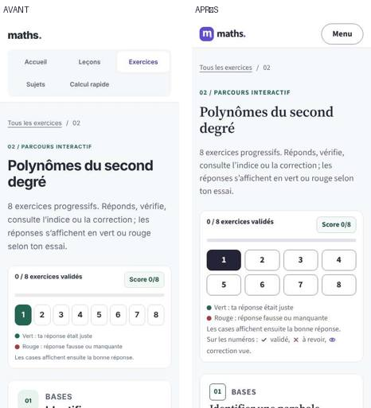 | En-tête d'une ligne, numéros en 4 × 2 avec icônes, réponses sans cadre, énoncé souligné d'un filet violet |
| Série (ordinateur) | 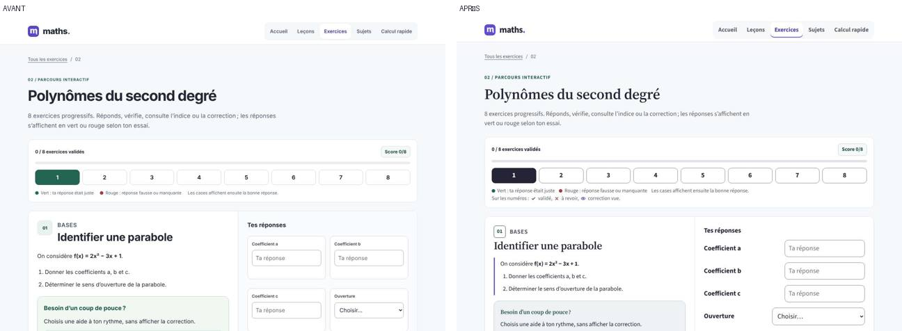 | Même disposition (énoncé et aides à gauche, réponses à droite), typographie et contours |
| Série de Terminale | 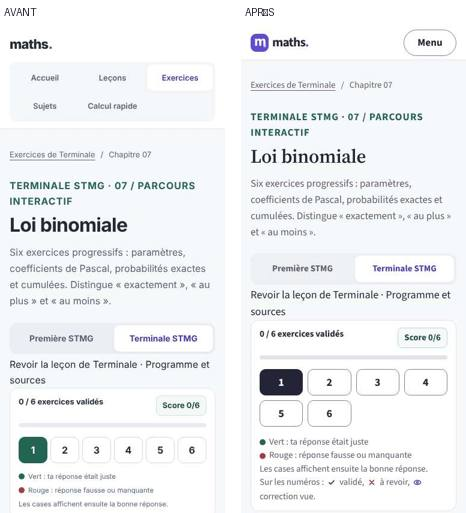 | Même gabarit qu'en Première |
| Leçon (téléphone) | 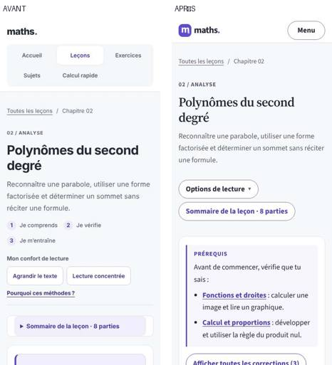 | « Options de lecture » replié, sommaire compact, prérequis en encadré à filet |
| Leçon (ordinateur) | 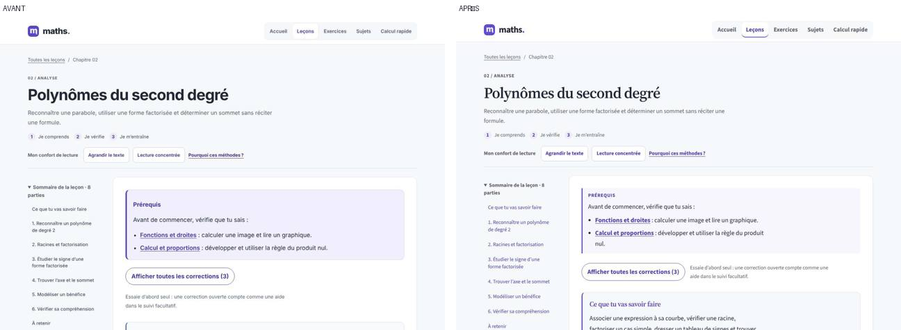 | Disposition inchangée, titres en serif, encadrés typés |
| Leçon de Terminale | 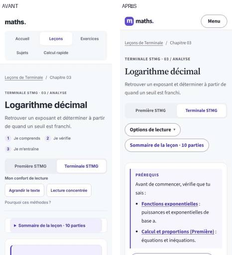 | Même gabarit qu'en Première |
| Catalogue des leçons | 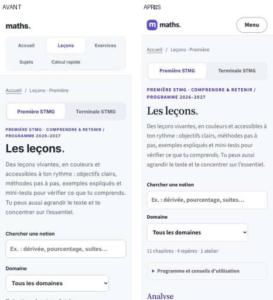 | Domaine en toutes lettres avec une icône, cartes homogènes |
| Catalogue des exercices | 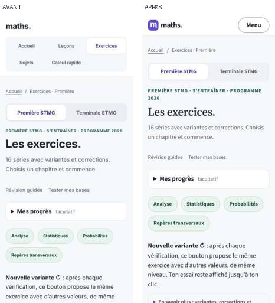 | Idem, avec le vert de l'entraînement |
| Diagnostic | 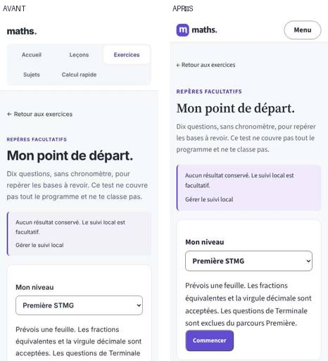 | Jetons, typographie, en-tête |
| Calcul rapide | 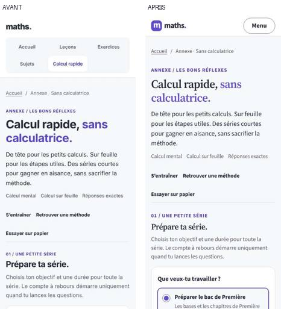 | Jetons, cases de 22 px, chiffres tabulaires |
| Sujet blanc | 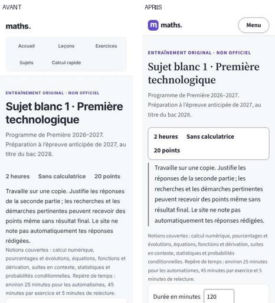 | Consignes encadrées, barème aligné à droite |
| Accueil (téléphone) | 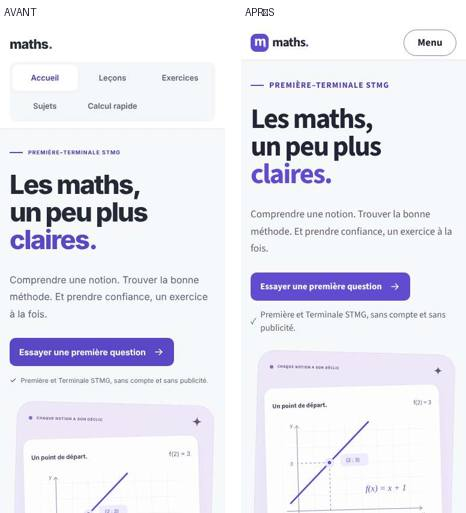 | En-tête seulement ; titre, illustration et question inchangés |
| Accueil (ordinateur) | 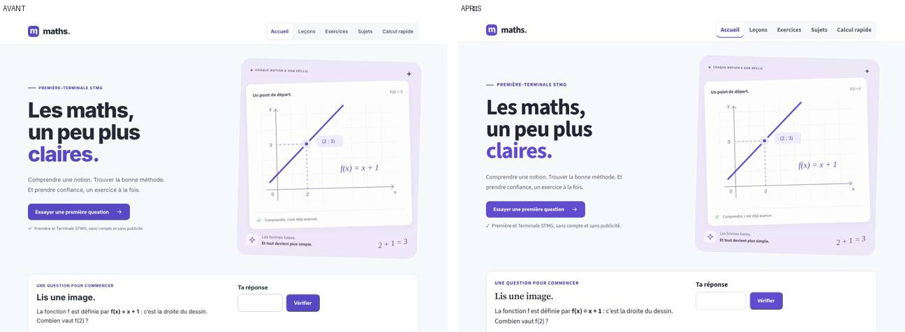 | Typographie des titres de section |

## Écarts par rapport au brief, et pourquoi

1. **Fond** : gris clair `#f7f8fa` conservé, par décision validée, au lieu du papier `#f8f7f3`.
2. **Polices en `font-display: optional`** au lieu de `swap` : avec `swap`, la leçon se décalait au chargement (CLS 0,13 sur réseau lent). Polices préchargées, polices de repli aux métriques ajustées : CLS à 0. Sur une connexion très lente, la police de repli peut rester affichée pour la visite.
3. **Signes mathématiques rares** (environ 20, par exemple ₙ, ∪, ∈ et ⇔) : absents des deux polices, ils sont dessinés par la police du système.
4. **Mode sombre** : d'abord écarté dans la direction, puis ajouté à ta demande, avec tous les composants vérifiés AA.
5. **Classe `.math`** : elle est définie (chiffres tabulaires, pas de coupure de ligne), mais n'est pas encore posée par les générateurs et les outils. Les formules gardent leur gras actuel. Il faut un lot dédié, qui modifiera les empreintes des générateurs.
6. **Progression locale sur les cartes des catalogues** (si le suivi est activé) : non faite.
7. **Règles mortes des anciennes feuilles** : non supprimées. La couche `refonte.css` les remplace sans les effacer, d'où la hausse du poids CSS.

## Tests

- **Node** (9) et **Python** (11) : tous passent.
- **Navigateur** : `browser_cloture`, `browser_smoke`, `browser_terminale`, `browser_evolution` et `browser_calcul_rapide` passent tous les cinq.
- **Tests adaptés, sans affaiblissement** :
  - le dossier `docs/` n'est plus traité comme une page du site ;
  - deux tests ouvrent le menu avant de mesurer les cinq liens de navigation, et `browser_smoke` ouvre « Options de lecture » avant de vérifier le confort de lecture sur téléphone ;
  - `browser_terminale` compare l'énoncé et les intitulés d'une variante. Il échouait au hasard une fois sur sept, quand une variante gardait la même fonction mais demandait une autre valeur.
- **Instabilité connue** : dans `browser_smoke`, la vérification « Indice figé pour exercice 3 » compare deux tirages successifs et peut échouer au hasard (une fois en quatre passages). Elle n'a pas de lien avec la refonte.
- **`check_publication.py`** compare le site en ligne au dépôt : à lancer après la fusion et le déploiement.

## À faire valider par une personne

1. Le rendu sur un vrai iPhone et un vrai Android, en clair et en sombre : menu, « Options de lecture », lien « Sommaire », numéros d'exercice.
2. La lisibilité des formules avec les nouvelles polices, en particulier les indices et les signes dessinés par la police du système.
3. L'impression d'une leçon et d'un sujet blanc sur papier.
4. Le parcours au lecteur d'écran du menu et du bilan de fin de série.
5. Le choix de la suite : pose de la classe `.math`, nettoyage des anciennes feuilles, progression sur les cartes.
